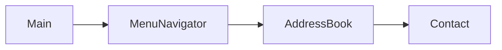

# Address Book

Небольшая консольная адресная книга на Java. В ней можно добавлять контакты, обновлять существующие по имени, удалять их по ID и просматривать список.

## Что умеет

| Действие | Поведение |
| --- | --- |
| Добавление | Сохраняет имя, должность, дату рождения, телефон и email |
| Повторное имя | Заменяет данные контакта; сравнение имён не зависит от регистра и лишних пробелов |
| Удаление | Удаляет контакт по ID, который виден в списке |
| Просмотр | Показывает все непустые записи |

Данные хранятся в памяти в массиве на 100 контактов. После закрытия приложения они не сохраняются. Это сознательное ограничение текущей версии.

## Быстрый запуск

Нужны JDK 17+ и Maven 3.8+.

```bash
mvn compile exec:java
```

Пример сеанса:

```text
Адресная книга
1 - добавить/обновить контакт
2 - удалить контакт
3 - список контактов
4 - выход
Введите 1..4: 1
Введите имя контакта: Иван Иванов
Должность: Java Developer
Дата рождения: 01.01.2000
Номер телефона: +375 29 000-00-00
Эл. почта: ivan@example.com
Новый контакт добавлен
```

## Устройство



`MenuNavigator` читает команды и поля контакта. `AddressBook` управляет массивом и ID. `Contact` хранит данные; равенство контактов определяется нормализованным полным именем.

## Проверка

```bash
mvn test
```

Сборка проверяет компиляцию проекта. Автоматические тесты и постоянное хранение данных запланированы для следующих этапов.

## Планы

- Проверки операций добавления, замены и удаления.
- Поиск контактов по имени.
- Сохранение списка между запусками.
